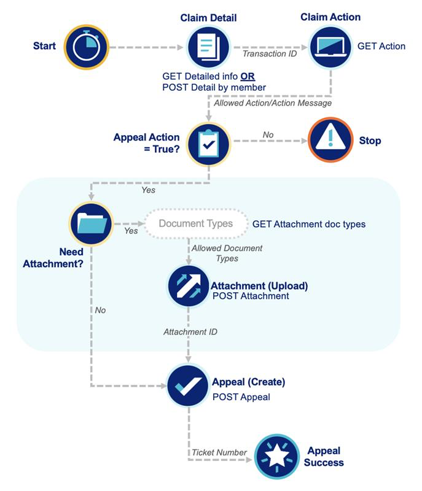

The Appeals workflow follows the same functionality as Reconsideration and enables both lookup and submission of a Reconsideration ticket. Appeals can be submitted via API by calling Claim Detail for the transaction ID, then Claim Action to determine the next step, before adding an Attachment if needed. Upon successful creation of the Appeal, a ticket number for reference will be provided.



# Create Appeal Attachment
```python
from optumapisdk.claims.input_models import AppealRequest

claim_status = client.claims.claim_detail.get_detail(
    claim_number = "<claim_number>"
    tin = "<tin>",
    include_summary = "<include_summary>" # optional, default = True
)

transaction_id = ...

available_actions = client.claims.claim_action.get_action(
    transaction_id="123456789",
    tin="98765432"
)

can_create = next(
    (ticket for ticket in available_actions.get('actions', {}) if ticket.get('ticketType') == 'APPEAL' and ticket.get('allowedAction') == 'CREATE'),
    None
) 

if can_create:
    document_types = client.claims.attachments.get_attachment_doc_types_v2(
        ticket_type="APPEAL",
        tin='23456789'
        )
    
    # can either upload a single file or a folder of files by either using the record_path_to_upload paramater or the folder_to_upload parameter
    attachment_info = client.claims.attachments.post_attachment(
        tin = '23456789',
        transactionId = '123456789',
        doc_type_code = 'M1',
        record_path_to_upload='path/to/your/file.pdf'
    )

    body = AppealRequest(
        transactionId="<transactionId>",
        hasAttachment=True,
        attachmentUploaded=True
    )

    ticket_info = client.claims.claim_appeal.post_appeal(
        body = body,
        tin='23456789'
    )
```

