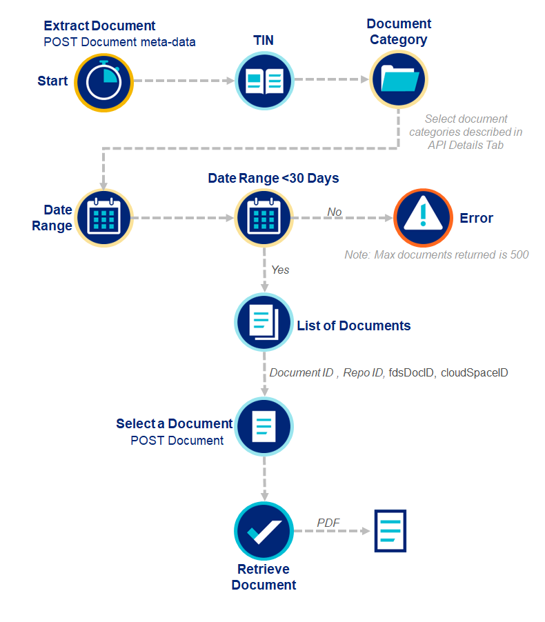

The Documents workflow provides access to individual or multiple documents attached to claims. Upon accessing a Document Key, document metadata can be reviewed or documents can be downloaded.



```python
from optumapisdk.claims.input_models import DocumentMetaDataRequest

# if auto-pagination is set to true, it will iterate all pages until all documents are retrieved
# if auto-pagination is set to false, user will need to loop through pages manually by setting the getPage parameter in DocumentMetaDataRequest
request_body = DocumentMetaDataRequest(
    toDt="03/01/2026",
    fromDt="01/01/2026",
    tin='123456789',
    auto_pagination=True, # default = true
    max_pages=10 
)
    
documents = client.claims.documents.post_document_metadata(request_body)

# extract the document id and repo id from the response
document_id = ...
repo_id = ...

request_body = DocumentDownloadRequest(
    tin='123456789',
    documentId=document_id,
    repoId=repo_id
)

document_byters = client.claims.documents.post_document(request_body)
```