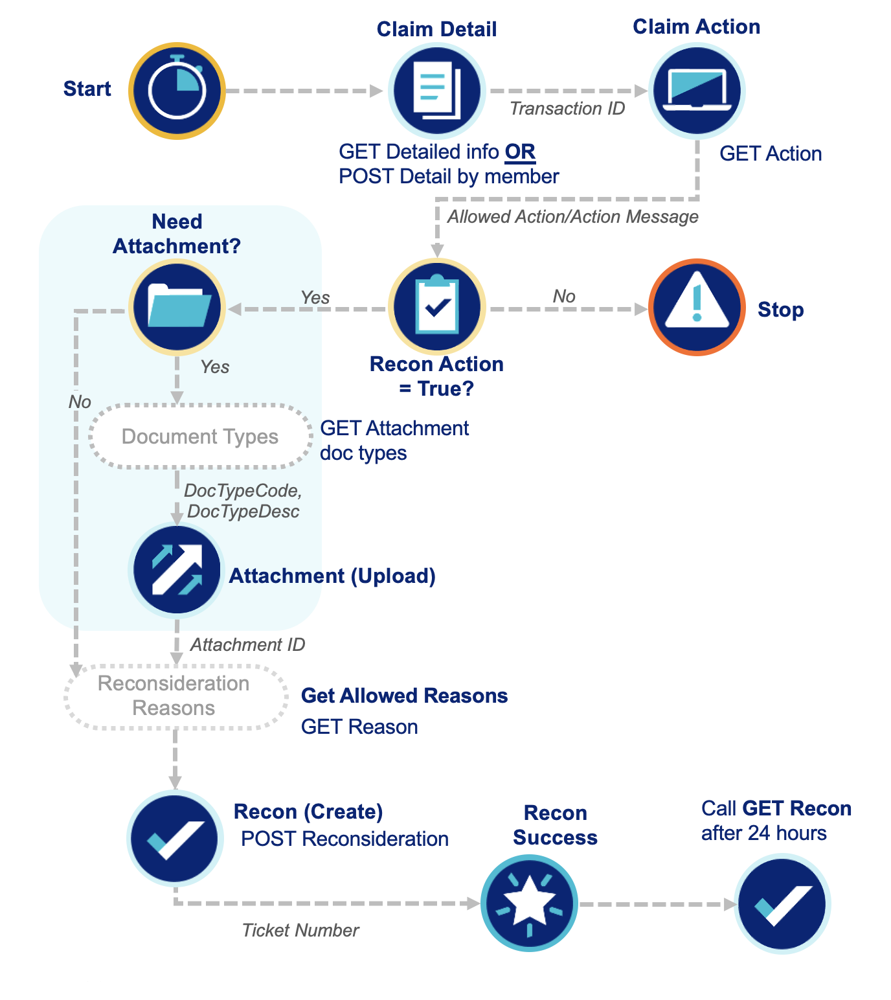
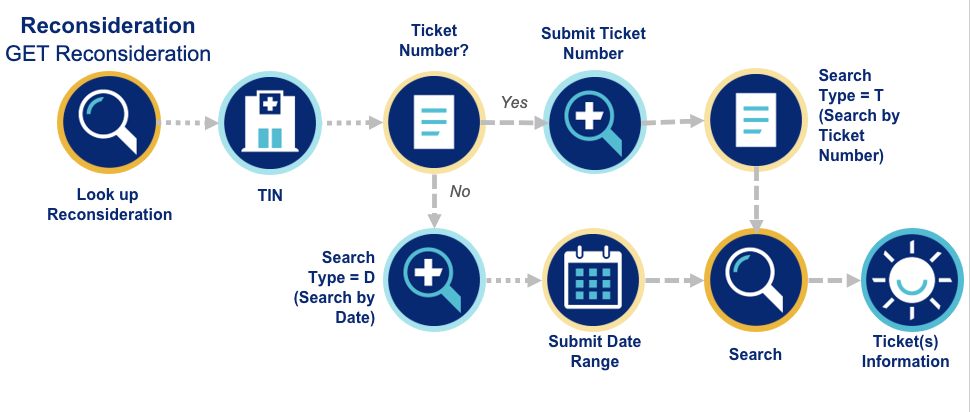

The Reconsideration workflow enables both lookup and submission of a Reconsideration ticket. Reconsiderations can be submitted via API by first calling Claim Detail for the transaction ID, Claim Action to determine the next step, and adding an Attachment if needed. Upon successful creation of the Reconsideration, a ticket number for reference will be provided.



## Create Reconsideration
```python
from optumapisdk.claims.input_models import ReconRequest

claim_status = client.claims.claim_detail.get_detail(
    claim_number = "<claim_number>"
    tin = "<tin>",
    include_summary = "<include_summary>" # optional, default = True
)

transaction_id = ...

available_actions = client.claims.claim_action.get_action(
    transaction_id="123456789",
    tin="98765432"
)

can_create = next(
    (ticket for ticket in available_actions.get('actions', {}) if ticket.get('ticketType') == 'RECON' and ticket.get('allowedAction') == 'CREATE'),
    None
) 

if can_create:
    document_types = client.claims.attachments.get_attachment_doc_types_v2(
        ticket_type="RECON",
        tin='23456789'
        )
    
    # can either upload a single file or a folder of files by either using the record_path_to_upload paramater or the folder_to_upload parameter
    attachment_info = client.claims.attachments.post_attachment(
        tin = '23456789',
        transactionId = '123456789',
        doc_type_code = 'M1',
        record_path_to_upload='path/to/your/file.pdf'
    )

    body = ReconRequest(
        transactionId=transaction_id,
        provComments="Your comments here",
        hasAttachment=True,
        attachmentUploaded=True,
        dontKnowDollarAmt=True,
        reqReason="Your reason here"
    )

    ticket_info = client.claims.claim_recon.post_recon(
        body = body,
        tin='23456789'
    )
```
Searching for existing reconsiderations can be conducted using the ticket type or date range.



## Get Recon Status (by Ticket Number)
```python
from optumapisdk.claims.input_models import ReconSearchType

recon_search_type = ReconSearchType.TICKET_NUMBER

ticket_details = client.claims.claim_recon.get_recon(
    tin = '23456789',
    ticket_number="PIQ-12345678",
    search_type=recon_search_type
)
```

## Get Recon Status (by Date Range)
```python
from optumapisdk.claims.input_models import ReconSearchType

recon_search_type = ReconSearchType.DATE_RANGE

client.claims.claim_recon.get_recon(
    tin = '23456789',
    first_subm_dt='01/01/2026',
    last_subm_dt='12/31/2026',
    search_type=recon_search_type
)
```